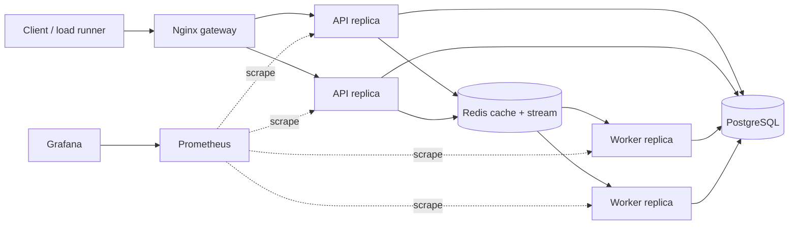

# Architecture and design decisions

## Context

TinyTune serves shareable playlists and counts track plays. Playlist mutation and
reads require durable relational state. Play ingestion favors low request latency
and temporary decoupling from analytics processing.

## Ownership and consistency

| Data | Owner | Consistency presented to clients |
|---|---|---|
| Playlist and tracks | PostgreSQL | Strong after committed mutation |
| Cached playlist projection | Redis | Eventual, bounded by invalidation and 30-second TTL |
| Accepted play event | Redis Stream | Durable according to Redis AOF policy |
| Play aggregate | PostgreSQL | Eventual in async mode; strong in baseline sync mode |
| Consumer idempotency ledger | PostgreSQL | Atomic with aggregate update |

PostgreSQL remains the only source of truth for product state. A Redis cache miss
never changes correctness; it changes latency and database load. Redis Stream is
the asynchronous handoff and therefore is availability-critical for accepting new
play events. The API returns 503 if it cannot persist that handoff.

## Delivery semantics

Redis consumer groups provide at-least-once delivery. The worker:

1. reads or claims a stale pending message;
2. inserts `event_id` into `processed_events`;
3. increments the track aggregate in the same PostgreSQL transaction;
4. acknowledges and deletes the stream entry after commit.

A crash between steps 3 and 4 causes redelivery. The unique `event_id` makes that
redelivery a successful no-op. A failure before commit leaves no ledger row and is
safe to retry. Three failures move an event to a dead-letter stream.

This is effectively-once aggregate behavior built from at-least-once delivery and
an idempotent transactional consumer; it is not a claim of exactly-once transport.

## Cache behavior

Reads use cache-aside. Track mutation commits to PostgreSQL and then deletes the
playlist cache key. That ordering avoids exposing an uncommitted track but admits
a narrow race where a concurrent reader can repopulate the old projection after
the delete. The TTL bounds the stale interval. Production alternatives include a
versioned key, compare-and-delete, a change-data-capture invalidator, or accepting
the bounded inconsistency as a product decision.

## Backpressure and overload

The API does not wait for analytics completion. When arrival rate exceeds worker
service rate, Redis Stream depth rises and exposes the deficit. This protects API
latency but does not create capacity; an operational queue-depth limit and load
shedding would be the next safety boundary.

Database pool acquisition is limited to one second. Once the pool is saturated,
the API returns 503 instead of retaining arbitrary numbers of requests and failing
through memory exhaustion. This converts an uncontrolled failure into a visible,
recoverable overload response.

## Scaling limits

- API scaling stops helping when PostgreSQL, Redis, or the host network dominates.
- The gateway uses DNS-aware upstream discovery plus a 256-connection keepalive
  pool; without pooling, repeated load steps accumulated `TIME_WAIT` sockets and
  reduced sustainable throughput.
- Complete metrics are retained while normal success logs are sampled at 1%.
  Synchronous per-request container logging became a saturation contributor during
  repeated tests; slow, failed, retried, duplicate, and dead-letter operations are
  never sampled away.
- Worker scaling stops helping when a single hot aggregate row serializes updates.
- Cache hit rate determines how much API scaling shifts load away from PostgreSQL.
- Redis currently combines cache and queue roles, coupling their capacity and
  failure domains for local simplicity.
- PostgreSQL and Redis are single instances in this local exercise.

## Security boundary

The customer app requires local or Google sign-in, with Redis-backed HttpOnly
sessions and server-side owner/editor/viewer checks for all product endpoints.
Reads authorize against PostgreSQL before consulting the content cache. Mutations
and sharing changes serialize on the playlist row. No anonymous demo bypass or
anonymous fixture API remains. Each load test registers a private fixture account.
The load lab (8081), read-only reference (8082) and Grafana (3000) are separate
local tools without login, as requested. Nginx fixes the upstream surface header,
blocks cross-surface paths and strips customer credentials on tool listeners.
All published ports bind to loopback. This is not an internet-facing deployment;
see `ACCESS_AND_SHARING.md` for guarantees, limitations and setup.

## Web control plane

The API serves local static assets and exposes session-protected library and load
job endpoints. A Redis job queue hands bounded experiments to one separate k6 runner.
Progress and reports live in Redis so browser polling works across API replicas.
The runner has a fixed local target and no Docker socket. It cannot scale services;
operators use Compose while the dashboard observes the changed metrics.

